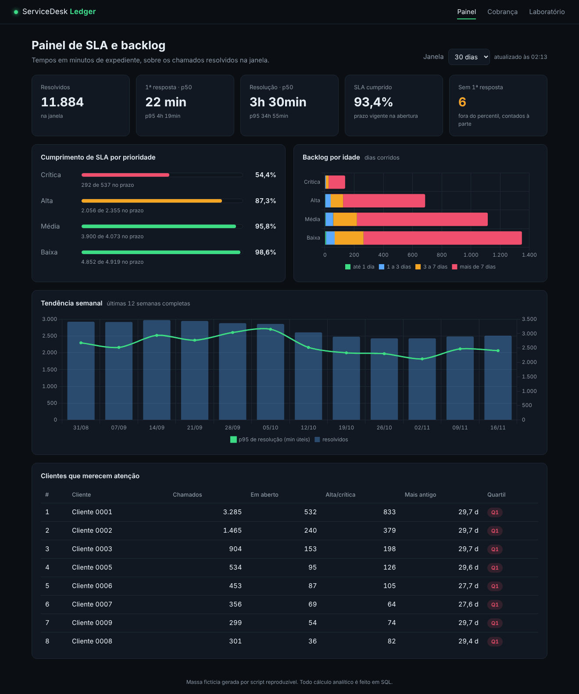
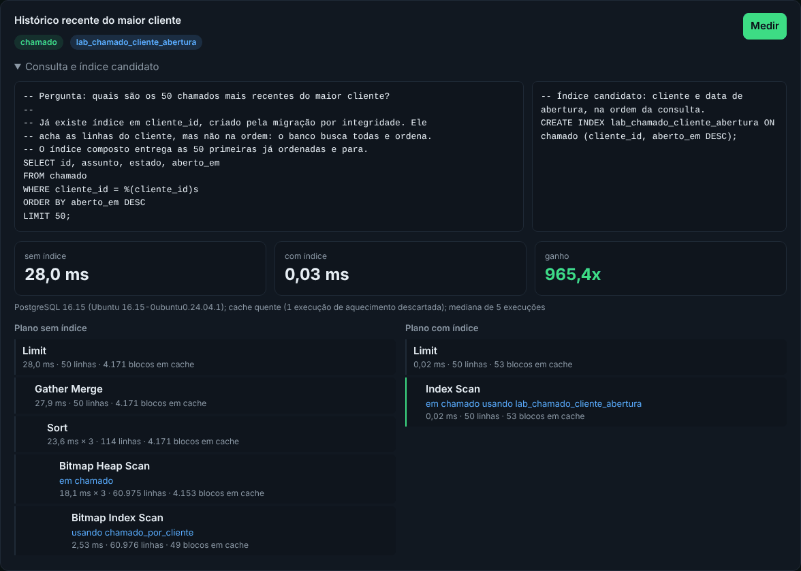
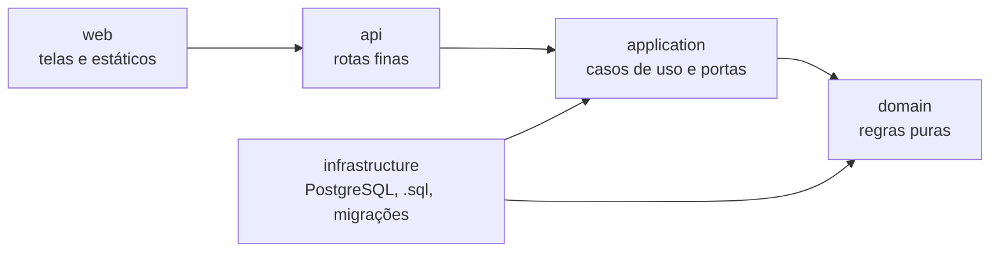

# ServiceDesk Ledger

**Quanto da sua fila está atrasada, quanto você está cobrando e quanto está perdendo — em um só lugar.**




## A dor

Pequenos prestadores de serviço e times de suporte atendem clientes por chamados
e não conseguem responder três perguntas: quanto da fila está atrasada, quanto
está sendo cobrado e quanto está sendo perdido. Os dados existem — no histórico
de chamados e nos planos dos clientes — mas ninguém os cruza.

Este projeto cruza, a partir do mesmo banco, com **todo o cálculo analítico feito
em SQL**.

## O que tem dentro

- **Painel de SLA e backlog.** Percentis p50, p90 e p95 de primeira resposta e de
  resolução em horas úteis, backlog por prioridade e idade, cumprimento de SLA
  pelo prazo que valia no dia da abertura, tendência semanal e ranking de
  clientes que merecem atenção.
- **Cobrança recorrente.** Fechamento de ciclo idempotente, franquia de horas com
  excedente cobrado em blocos de 15 minutos, receita por competência, receita em
  atraso por faixa de idade e churn mensal.
- **Laboratório de índices.** Cada consulta pesada é medida sem e com o índice
  candidato, com os dois planos de execução lado a lado. O índice é criado e
  removido de verdade, num banco só do laboratório.



## Como rodar

```bash
git clone https://github.com/Wally-SC/servicedesk-ledger.git
cd servicedesk-ledger
make up              # PostgreSQL e aplicação; cria o .env na primeira vez
make migrar          # esquema do banco
make semear-grande   # 300 mil chamados e o histórico de faturas, cerca de 1 minuto
```

Abra **http://localhost:8000**. Para uma massa de 2 mil chamados, em segundos, use
`make semear` no lugar de `make semear-grande`.

Laboratório de índices:

```bash
make laboratorio-preparar   # migra e semeia o banco do laboratório
make laboratorio-medir      # mede todos os experimentos e imprime a tabela
```

Na tela do laboratório, o botão **Medir** pede o valor de `LAB_TOKEN` do `.env`.
Troque o valor padrão. Para desligar o DDL por completo, `LAB_HABILITADO=false`.

Sem `make`, cada alvo é um comando de `docker compose`: veja o `Makefile`.

## Arquitetura

Camadas com as dependências apontando para dentro:



A escrita passa por caso de uso e domínio. **A leitura analítica não**: vai do
arquivo `.sql` direto para um modelo de leitura, sem materializar entidade. O
porquê está no [ADR-0001](docs/decisoes/0001-arquitetura-em-camadas-e-leitura-separada.md).
A regra de dependências é verificada por um teste que lê o código com `ast`, e
não só prometida aqui. Detalhes em [docs/arquitetura.md](docs/arquitetura.md).

## Destaques de SQL

Cada consulta vive num arquivo próprio, que começa dizendo a pergunta de negócio
que responde.

| Técnica | Onde | Para quê |
|---|---|---|
| `PERCENTILE_CONT` | [percentis_de_atendimento.sql](src/sdledger/infrastructure/sql/painel/percentis_de_atendimento.sql) | p50, p90 e p95 sobre a coorte de chamados entregues |
| Agregação com `FILTER` | [backlog_por_idade.sql](src/sdledger/infrastructure/sql/painel/backlog_por_idade.sql), [receita_em_atraso.sql](src/sdledger/infrastructure/sql/faturamento/receita_em_atraso.sql) | faixas de idade numa varredura só |
| `JOIN LATERAL` | [taxa_de_sla.sql](src/sdledger/infrastructure/sql/painel/taxa_de_sla.sql), [churn_mensal.sql](src/sdledger/infrastructure/sql/faturamento/churn_mensal.sql) | o plano e a política de SLA vigentes no dia da abertura |
| `LAG` e `SUM OVER` | [tendencia_semanal.sql](src/sdledger/infrastructure/sql/painel/tendencia_semanal.sql), [receita_por_competencia.sql](src/sdledger/infrastructure/sql/faturamento/receita_por_competencia.sql) | variação e acumulado sem autojunção |
| `ROW_NUMBER` e `NTILE` | [ranking_de_clientes.sql](src/sdledger/infrastructure/sql/painel/ranking_de_clientes.sql) | posição e quartil de criticidade |
| `daterange` e `EXCLUDE USING gist` | [migração 0001](src/sdledger/infrastructure/migracoes/versions/0001_clientes_planos_contratos.py), [0003](src/sdledger/infrastructure/migracoes/versions/0003_sla_e_expediente.py) | dois contratos ou duas políticas valendo no mesmo dia não entram no banco |
| Função SQL de horas úteis | [migração 0003](src/sdledger/infrastructure/migracoes/versions/0003_sla_e_expediente.py) | o relógio de SLA conta expediente e pula feriado |
| Índices parciais e compostos | [laboratório](src/sdledger/infrastructure/sql/laboratorio/indices/) | medidos antes de existirem |

As definições de cada métrica estão no [glossário](docs/metricas.md). Não há view
materializada: a consulta mais pesada do painel fica abaixo de 1 segundo com 300
mil chamados, e a decisão era materializar só o que a medição mostrasse lento.

## Laboratório de índices: resultados

Massa grande (300 mil chamados), PostgreSQL 16, 2 vCPUs, cache quente, mediana de
9 execuções. Faixa de ganho em três rodadas:

| Experimento | Sem índice | Com índice | Ganho nas três rodadas |
|---|---:|---:|---:|
| Histórico recente do maior cliente | 28,0 ms | 0,04 ms | 401x a 866x |
| Backlog em aberto, índice parcial | 19,3 ms | 0,56 ms | 31x a 42x |
| Respostas públicas por dia | 43,9 ms | 6,12 ms | 5,6x a 7,2x |
| Chamados entregues na janela | 18,3 ms | 6,29 ms | 1,9x a 2,9x |
| Consumo de horas do mês | 53,6 ms | 47,0 ms | 1,0x a 1,1x |

O último é o resultado mais útil: o planejador usa o índice, e a consulta quase
não melhora, porque o gargalo é a junção com os 300 mil chamados e não o filtro
de data. Explicação de cada um, ambiente e protocolo em
[docs/laboratorio/resultados.md](docs/laboratorio/resultados.md).

## Como a IA foi usada

A IA trabalhou como um engenheiro sênior em revisão de design: propôs opções com
prós e contras e uma recomendação; eu decidi. Cada decisão relevante tem um
[registro](docs/decisoes/) escrito no mesmo pull request que a implementa, com uma
seção para o que deu errado — e ela só é preenchida quando algo deu errado de
verdade. Os registros e os pull requests anotam mais de quinze problemas reais,
entre eles uma constraint que recusava evento de resolução, uma massa que gerava
R$ 107 milhões de receita, um laboratório que media pior por causa de uma tabela
nunca aspirada e uma imagem Docker sem o `alembic.ini`.

O método, inclusive o que eu não deixei a IA fazer, está em
[docs/uso-de-ia.md](docs/uso-de-ia.md).

## Estratégia de Git e de testes

- **30 pull requests**, cada um com um tema só, descrição do que, por que e como
  testar. Merge commit em vez de squash ou rebase, para preservar a assinatura de
  cada commit — `git log --first-parent` dá a visão por PR
  ([ADR-0004](docs/decisoes/0004-processo-de-pull-request.md)).
- Commits pequenos no padrão Conventional Commits, em português, com o porquê no
  corpo, assinados por SSH.
- **204 testes**: 111 de unidade, sem banco; 62 de integração contra PostgreSQL
  real, cada um numa transação desfeita no fim; 25 de API com dublês; 4 de
  arquitetura; 2 de configuração.
- Os testes das consultas fixam invariantes, não números: `p50 <= p90 <= p95`, as
  faixas do backlog somando o total, a primeira semana da tendência com variação
  nula e não zero.
- A esteira roda formatação, lint, `mypy --strict` e a suíte inteira contra um
  PostgreSQL de serviço em todo pull request.

## Roadmap

O que está decidido e ainda não foi feito:

- **Desconto das pausas no relógio de SLA.** A tabela de períodos de estado já
  existe; o tempo em "aguardando cliente" ainda conta como tempo de atendimento.
- **Deploy público** com massa reduzida e o laboratório desligado.
- **Ruleset** exigindo a esteira verde na `main` quando o repositório abrir.
- **Medição com cache frio** no laboratório.

## Licença

A definir.
