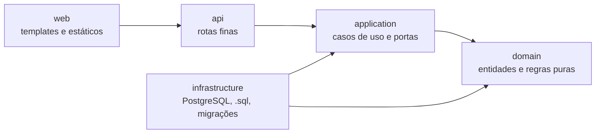

# ServiceDesk Ledger

**Quanto da sua fila está atrasada, quanto você está cobrando e quanto está perdendo — em um só lugar.**


## A dor

Pequenos prestadores de serviço e times de suporte atendem clientes por chamados
e não sabem responder três perguntas básicas: quanto da fila está atrasada, quanto
está sendo cobrado e quanto está sendo perdido. Os dados existem — estão no
histórico de chamados e nos planos dos clientes — mas ninguém os cruza.

Este projeto responde as três a partir do mesmo banco, com **todo o cálculo
analítico feito em SQL**, não em Python.

## Estado atual

Este repositório está em construção e o README só afirma o que já está
implementado. Hoje roda:

- Ambiente completo em um comando (`make up`): PostgreSQL com o banco da
  aplicação e o banco do laboratório de índices, mais a API.
- Rota `/saude`, que responde 503 quando o banco não responde.
- Teste de arquitetura que reprova qualquer dependência apontando para fora.

O que ainda não existe está no [roadmap](#roadmap), e nenhuma seção deste
documento descreve algo que ainda não foi escrito.

## Como rodar

```bash
git clone https://github.com/Wally-SC/servicedesk-ledger.git
cd servicedesk-ledger
make up
curl http://localhost:8000/saude
```

O `make up` copia o `.env.example` para `.env` na primeira vez. Nenhuma
credencial vive no repositório.

## Arquitetura

Arquitetura em camadas, com as dependências apontando para dentro:



A escrita passa por caso de uso e domínio. **A leitura analítica não**: ela vai
do arquivo `.sql` direto para um DTO declarado em `application/consultas`, sem
materializar entidade. O porquê está em
[ADR-0001](docs/decisoes/0001-arquitetura-em-camadas-e-leitura-separada.md).

Detalhes de cada camada em [docs/arquitetura.md](docs/arquitetura.md).

## Decisões

Toda decisão relevante tem um registro em [docs/decisoes](docs/decisoes/), com
as opções consideradas, o que foi decidido, o que deu errado no caminho e como
reverter. Os registros são escritos no mesmo pull request que implementa a
decisão — nunca numa limpeza no fim.

## Estratégia de Git e de testes

- Nada entra na `main` sem pull request, e cada PR faz uma coisa só.
- Commits pequenos no padrão Conventional Commits, em português, com o porquê no
  corpo da mensagem.
- Commits assinados por SSH.
- Testes de unidade no domínio (sem banco), testes de integração das consultas
  contra um PostgreSQL de verdade em contêiner, e testes de API.
- Um teste de arquitetura lê o código com `ast` e falha se `domain` ou
  `application` importarem framework, banco ou camada de fora. A regra é
  verificada, não prometida.

## Roadmap

1. Modelo de dados, migrações e política de SLA com vigência
2. Massa fictícia reproduzível (perfil pequeno para teste, grande para o laboratório)
3. Domínio de chamado e SLA em horas úteis
4. Consultas do painel: percentis, backlog, taxa de SLA, tendência, ranking
5. API e front do painel
6. Cobrança recorrente: franquia, excedente, receita em atraso e churn
7. Laboratório de índices com `EXPLAIN (ANALYZE, BUFFERS)` antes e depois

## Licença

A definir.
