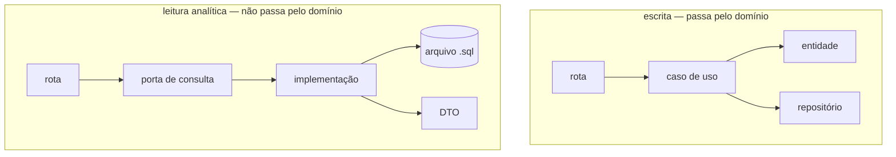

# Arquitetura

## Por que cada camada existe

### `domain`

Entidades e regras de negócio puras: chamado e suas transições, política de SLA,
plano e franquia, ciclo de faturamento. Não importa framework, banco nem HTTP.

Existe para que a regra que dá valor ao produto — quando um chamado violou o SLA,
quanto de hora excedente um cliente consumiu — possa ser testada em milissegundos,
sem subir contêiner, e para que trocar FastAPI ou PostgreSQL não a alcance.

### `application`

Casos de uso e portas. Um caso de uso orquestra o domínio e fala com o mundo
apenas por interfaces declaradas aqui: repositórios, consultas, relógio, unidade
de trabalho.

Existe para que a ordem das operações de um fluxo ("abrir chamado" é validar,
persistir, registrar evento) fique num lugar só, e para inverter a dependência:
quem conhece PostgreSQL é a infraestrutura, e é ela que se encaixa nestas portas.

### `infrastructure`

Implementações concretas: conexão, repositórios, carregamento das consultas em
`.sql`, migrações e o runner do laboratório. Conhece PostgreSQL; não conhece HTTP.

`infrastructure/sql/` é pasta de primeira classe porque o SQL é produto neste
projeto, não detalhe de implementação. Cada arquivo responde uma pergunta de
negócio, é revisado como código e é a unidade medida no laboratório de índices.

### `api`

Rotas FastAPI finas. Traduzem HTTP para caso de uso ou para consulta, e traduzem
o erro de volta. Nenhuma regra de negócio mora aqui.

### `web`

Templates e estáticos servidos pelo próprio projeto.

## Os dois caminhos

**Escrita.** Abrir um chamado, apontar horas, fechar um ciclo. Passa por caso de
uso, carrega a entidade, aplica a regra, persiste. É onde a invariante vive.

**Leitura analítica.** Percentil de primeira resposta, backlog por faixa de idade,
ranking de clientes críticos. Não é entidade: é modelo de leitura. Vai do arquivo
`.sql` direto para um DTO declarado em `application/consultas`.

Forçar o painel a passar pelo domínio significaria materializar centenas de
milhares de entidades para agregá-las em Python — exatamente o contrário do que
este projeto quer demonstrar. O preço de manter a regra "dependências apontam
para dentro" é que a porta da consulta fica em `application/portas`: a rota
depende da interface, não do SQL.

## Os casos de uso que existem

Dois fluxos de escrita passam pelo caminho completo, de rota a repositório:

- **`FecharCiclo`** — fecha a competência de todos os clientes com contrato,
  calcula a fatura no domínio (mensalidade, franquia, excedente em blocos de 15
  minutos) e grava ciclo, fatura e itens. É idempotente: rodar de novo pula quem
  já foi fechado. A massa fictícia usa este mesmo caso de uso para gerar o
  histórico de faturas, então a regra testada é a regra que produz os dados.
- **`SolicitarMedicao`** — valida o experimento contra o catálogo e recusa um
  pedido quando já há medição em andamento. A execução roda fora da requisição,
  com uma trava consultiva no PostgreSQL como garantia final.

## O que garante a regra

`tests/arquitetura/test_dependencias.py` lê cada arquivo das camadas com `ast` e
falha quando `domain` ou `application` importam framework, banco ou camada de
fora, e quando `infrastructure` importa HTTP. A regra é verificada pela esteira,
não prometida no README.
